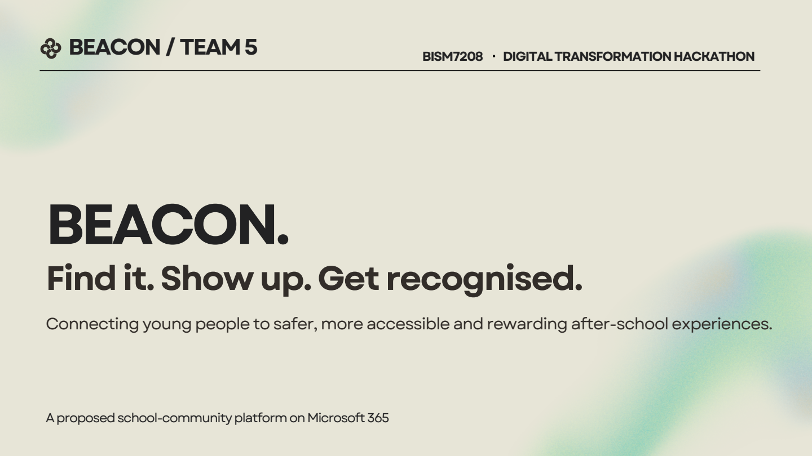
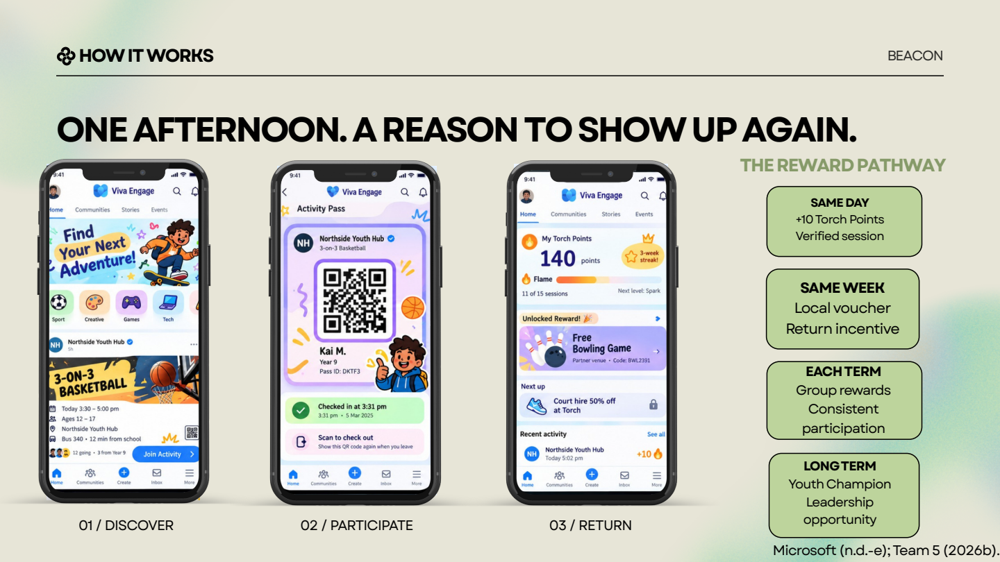
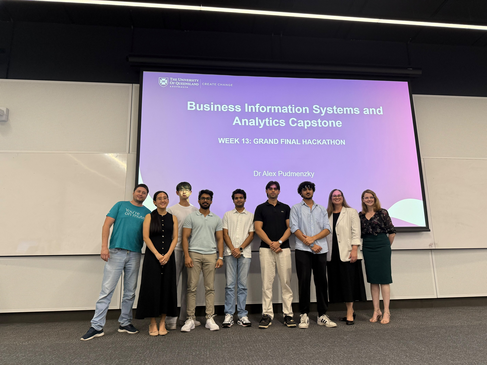

# Beacon | UQ × Microsoft Hackathon 2026

**🥈 Second Place · Team 5 · UQ–Microsoft Digital Transformation Hackathon, 2026**

**Microsoft 365 · Power Platform · Youth Engagement · Data Analysis · Technology Innovation**

Beacon is our proposed school–community platform that helps young people discover trusted after-school activities, verify participation and earn recognition for returning. We developed the solution for the University of Queensland Business School hackathon in partnership with Microsoft, with the final judged by Microsoft.

This project shows how I connect research, data analysis, technical architecture and prototype design to address a social problem with a practical digital solution.

**[繁體中文](README.zh-TW.md) · [Our solution](docs/solution.md) · [Architecture](docs/architecture.md) · [Pitch deck](docs/presentations/beacon-pitch-19-pages.pdf) · [My contribution](docs/my-contribution.md)**

## The challenge

Young people can face several barriers to after-school participation at once: difficulty finding activities, cost and transport, attending alone, perceived safety and limited choice. Beacon focuses on making the first visit easier and giving students a reason to return.

Our target group is students aged **12–16**. The proposed pilot covers **five schools, approximately 4,000 students with access, over 12 months**. These figures describe the proposed pilot scope.

## Our solution

| Step | Student experience | Proposed technology |
| --- | --- | --- |
| **Discover** | Find school-linked activities, see relevant details and connect with peers | Viva Engage and Microsoft Teams |
| **Participate** | Register, use Beacon Pass / QR attendance and have a session verified | Power Apps, Dataverse, Power Automate and Power Pages |
| **Return** | Receive Torch Points, explore partner rewards and progress towards Youth Champion opportunities | Attendance and reward workflows |
| **Understand engagement** | Give schools and partners an aggregate view of participation and return visits | Power BI, with proposed governance using Purview |

The hackathon materials include a solution proposal, screen mockups, Microsoft architecture, stakeholder value propositions, business modelling and a pilot plan. The supplied files do not include an executable app or a Power Platform solution export.

## My contribution and technology innovation

I contributed to **technical architecture, prototype work, data analysis, research, solution design and team collaboration**. The second-place result recognises the work of the whole team.

| Capability | How it appears in Beacon | Explore |
| --- | --- | --- |
| Translate research into a product | Connect participation barriers to activity discovery, trusted hosts and repeat-attendance incentives | [Solution rationale](docs/solution.md) |
| Design a connected technology solution | Assign discovery, attendance, automation, reporting and governance to a coherent Microsoft ecosystem | [Proposed architecture](docs/architecture.md) |
| Develop and communicate a prototype | Explain the Discover → Participate → Return journey through screen designs | [Original prototype slide](docs/assets/prototype-journey.png) |
| Use data to shape decisions | Connect contextual evidence to the problem and define attendance and retention measures for a pilot | [Evaluation plan](docs/pilot-and-evaluation.md) |
| Work across technical and business needs | Align student value with school oversight, partner participation, funding and delivery risks | [Business model](docs/business-model.md) |

Beacon's innovation is the connection between these elements: **school-linked discovery, verified participation, return incentives and aggregate engagement evidence**. It brings existing technology and community activities into one proposed participation journey.

## Recognition and the team

Our team achieved **second place in the 2026 UQ–Microsoft Digital Transformation Hackathon**. This is a team achievement within the UQ capstone event.

Read the [achievement record](docs/evidence/achievement.md) and [my contribution statement](docs/my-contribution.md) for the event context and my role in the shared team project.

## Review the project

| Material | Contents |
| --- | --- |
| [19-page PDF pitch](docs/presentations/beacon-pitch-19-pages.pdf) | Main reading reference for the solution and pilot proposal |
| [19-slide PowerPoint](docs/presentations/beacon-pitch-19-slides.pptx) | Supplied editable variant; personal author metadata removed from the publication copy |
| [17-slide PowerPoint](docs/presentations/beacon-pitch-17-slides.pptx) | Alternative supplied variant, revised financial figures and reference slides |
| [Solution](docs/solution.md) | Problem, audience, features, value proposition and differentiation |
| [Architecture](docs/architecture.md) | Proposed Microsoft components, information flow and implementation boundaries |
| [Pilot and evaluation](docs/pilot-and-evaluation.md) | Pilot scope, measures and decisions before scaling |
| [Business model and version notes](docs/business-model.md) | Funding approach and a comparison of differing financial snapshots |
| [Design history](docs/design-history/README.md) | Four annotated slide reviews and the separate revenue-model graphic |
| [Evidence and source inventory](docs/evidence/README.md) | Provenance, checksums, publication changes and duplicate handling |

The financial snapshots use different assumptions. Read the [version comparison](docs/business-model.md#financial-snapshots) before reusing their numbers. Funding, licensing support, partner agreements and wider social outcomes remain proposals requiring validation.

**Portfolio owner:** Yi Cheng Lee (Eason) · **Solution:** Beacon, Team 5 · **Context:** BISM7208, University of Queensland, 2026.

Repository organisation, previews and bilingual documentation were prepared with AI assistance from the supplied materials. Original team work and newly written explanations are identified in the [evidence notes](docs/evidence/README.md). Materials retain their respective owners' rights; see [NOTICE](NOTICE.md).
