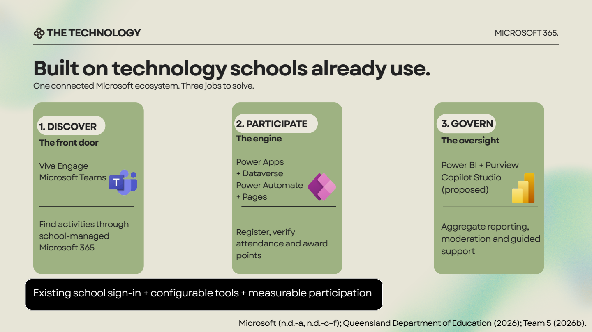
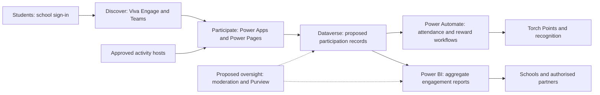

# Proposed Microsoft architecture

The team pitch divides Beacon into three responsibilities: **Discover, Participate and Govern**. This document explains that conceptual architecture. It is not an inventory of provisioned Microsoft services.

**Source:** [19-page pitch](presentations/beacon-pitch-19-pages.pdf), pages 6–7 and 13–14.

## Responsibilities in the proposal

| Component | Role assigned by the pitch | Evidence still needed for implementation |
| --- | --- | --- |
| Viva Engage / Teams | Familiar, school-managed activity discovery and communication | School tenant permission, age/usage eligibility and agreed access model |
| Power Apps | Registration and attendance interaction | App export, configured connectors, role definitions and user testing |
| Power Pages | Proposed external participation / partner interface | Authentication, external-user licensing and permission design |
| Dataverse | Proposed data layer for participation workflows | Schema, ownership model, access tests and retention settings |
| Power Automate | Verification and reward workflow automation | Exported flows, duplicate handling, failure recovery and acceptance evidence |
| Power BI | Aggregate participation and engagement reporting | Data model, metric definitions and tested report access |
| Purview | Proposed governance and compliance support | Agreed controls, licensing and configuration evidence |
| Copilot Studio | Proposed guided-support extension | A defined support scope, escalation process and evaluation before use |

These roles describe the team's chosen architecture. Product availability and licensing would need to be checked for the actual school environment before implementation.

## Proposed information flow

Approved activities enter the discovery experience. A student registers, attends and has the session verified. The attendance record then supports reward processing and aggregate reporting. This connects a visible student action to evidence that schools can review.

The original files do not contain an exported Dataverse schema. A detailed entity model, API contract and production integration would therefore be additional engineering work.

## Safeguarding and governance

The pitch calls for screened hosts, consent, moderation, school oversight and aggregate reporting. It also states that prospective partners should not receive individual student data. The revenue-model graphic states that Beacon would not sell student data.

Before a pilot, the implementation would need a documented consent model, least-access permissions, attendance correction process, retention rules and incident escalation. These are proposed delivery requirements derived from the concept, rather than controls demonstrated as configured in the supplied materials.

## Current technical evidence

Available: architecture slide, student screen mockups, workflow concept and stakeholder operating model.

Not supplied: runnable app source, Power Platform solution exports, cloud configuration, a tenant deployment, participant data or execution logs. The repository preserves and explains the hackathon design without claiming those missing implementation artifacts.
