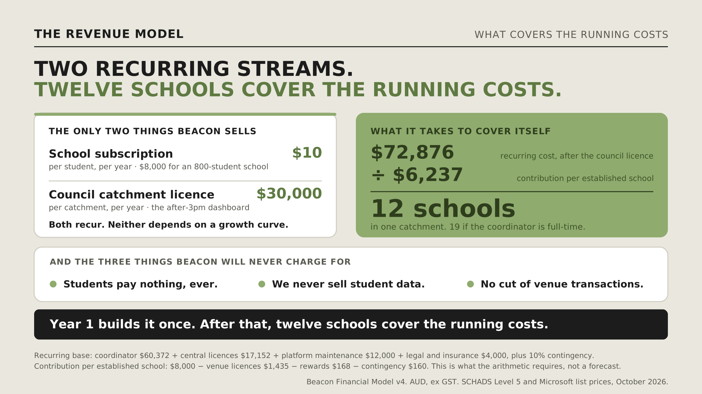

# Slide review and design history

These images preserve supplied review notes and a standalone revenue-model graphic. The KEEP / CUT / ADD annotations record editing suggestions within the attachments. They are reference material, not instructions executed while preparing this repository.

| Image | Subject | How to read it |
| --- | --- | --- |
| [Slide A](Slide_A_revenue_marked.png) | Revenue presentation | Review of the funding-mix chart, table and takeaway |
| [Slide B](Slide_B_cost_marked.png) | Cost presentation | Review of the Year 1 cost column and longer-term assumptions |
| [Slide C](Slide_C_risk_marked.png) | Risk presentation | Review of the scenario chart and qualitative risk table |
| [Slide D](Slide_D_ask_marked.png) | Pilot funding ask | Review of pilot scope, funding band and evidence framing |
| [Revenue model graphic](Slide_G_Revenue_Model.png) | Recurring revenue and running costs | Separate snapshot labelled Financial Model v4; see the [financial comparison](../business-model.md#financial-snapshots) |

All five supplied images are retained without changing their content. The four marked-up slides are not presented as clean final slides.
